# Work Management — User Journey (Tenant Owner)

**Account:** Dapi Owner (`dapi.onexso.com:4200`, tenant *Dapi Technologies*)
**Captured:** 2026-10-23, local dev environment, viewport 1440 px wide
**Scope:** Work Management module only (plus the Home dashboard as the entry point)
**Sample project:** *Onexso – HR and Work Management System*

Every screenshot is a single full-page image: pages that scroll were captured top to bottom in one shot.

---

## Journey at a glance

```
Home Dashboard
   └─► Work (Projects list) ──► Create project (4-step wizard)
          └─► Open project structure
                 ├─► Tree tab
                 │     ├─ View 1: Tree (module list)  ── Expand all / Highlight filter
                 │     │     ├─ Select module ─► Module Details panel ─► Members / Add work item
                 │     │     └─ Select task   ─► Task Details panel   ─► View task (full modal)
                 │     └─ View 2: Network (graph)
                 ├─► Board tab   (Kanban by status)
                 ├─► Backlog tab (table of all work items)
                 └─► Settings tab (task statuses + categories)
Inbox ─► Work approval requests (Approve / Reject)
```

---

## Step 1 — Home Dashboard

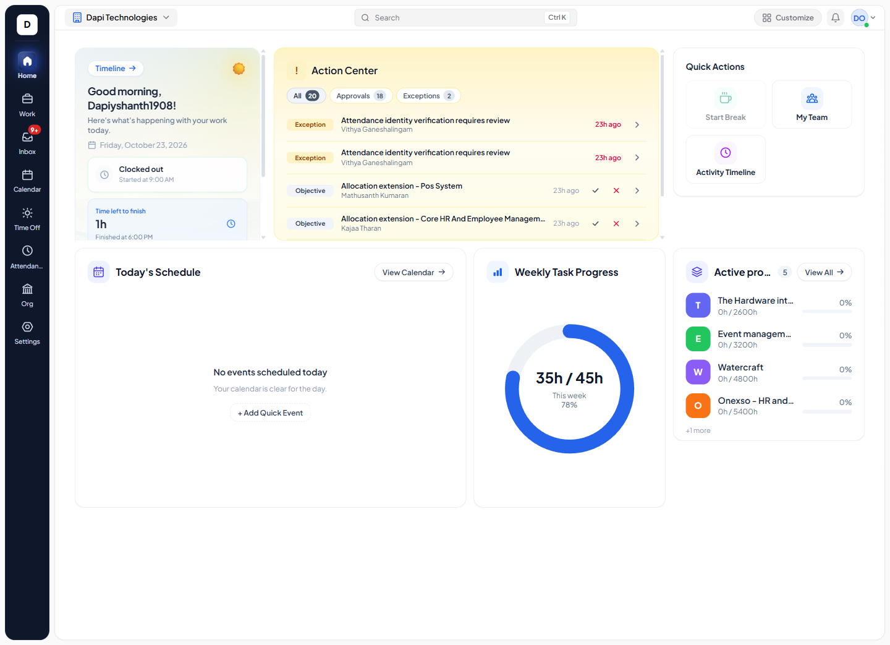

The owner lands on the customizable dashboard after login.

- **Greeting / Timeline card:** today's clock status and time left in the workday.
- **Action Center:** everything waiting on the owner, with filter chips (All / Approvals / Exceptions). Work Management approvals such as *Allocation extension* appear here with inline approve (✓) and reject (✕).
- **Weekly Task Progress:** hours logged on tasks this week against the planned hours (35h / 45h, 78%).
- **Active projects:** the Work Management projects the owner can see, with allocated hours and progress. **View All** opens the Work module.
- **Customize** (top bar) lets the user rearrange or resize widgets.

## Step 2 — Work: Projects list

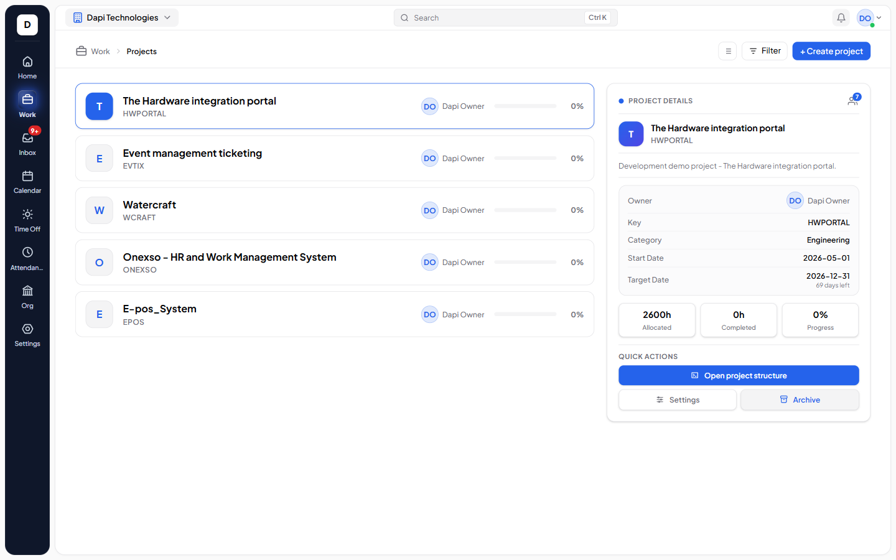

Clicking **Work** in the sidebar opens the projects list.

- Each row shows the project name, key (e.g. `ONEXSO`), owner and progress.
- Selecting a row fills the **Project Details** panel on the right: owner, key, category, start/target dates (with days left), and allocated hours / completed hours / progress.
- **Quick actions:** *Open project structure* (enters the project), *Settings*, *Archive*.
- The top bar has a list/grid toggle, **Filter** and **+ Create project**.

## Step 3 — Create a project

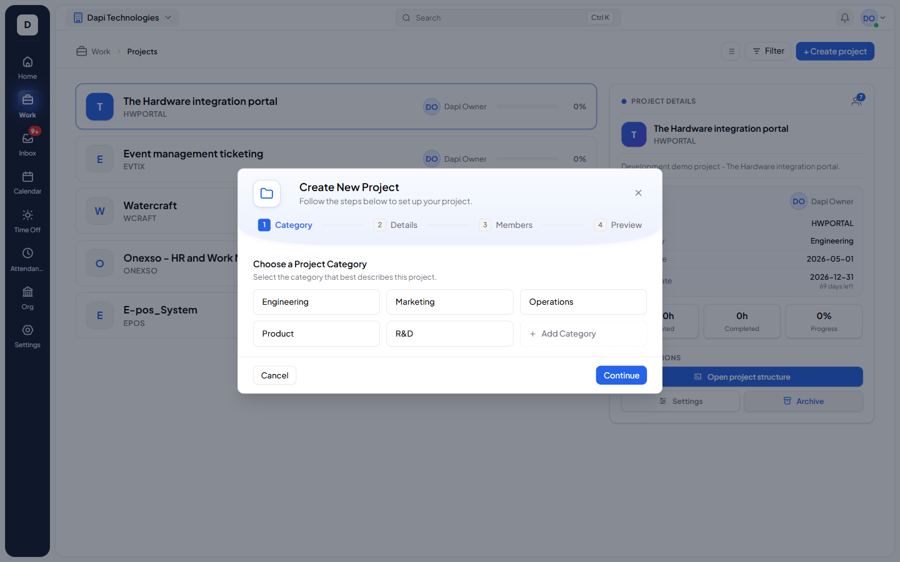

**+ Create project** opens a 4-step wizard: **Category → Details → Members → Preview**.
Step 1 picks a category (Engineering, Marketing, Operations, Product, R&D) or adds a new one.

## Step 4 — Project structure: Tree view (collapsed)

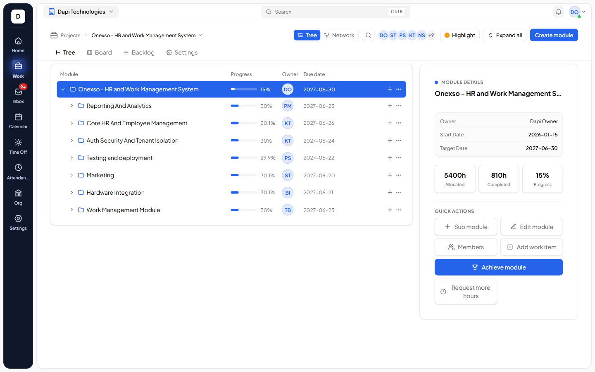

**Open project structure** lands on the **Tree** tab. The tab bar gives Tree / Board / Backlog / Settings.

- The tree lists the project's root module and its child modules with **Progress**, **Owner** and **Due date** columns.
- The header has the **Tree | Network** view switch, tree search, project member avatars, **Highlight**, **Expand all** and **Create module**.
- The right panel shows **Module Details** for the selected node (root by default): owner, dates, allocated/completed hours and progress, and quick actions.

## Step 5 — Tree view 1: Tree (fully expanded)

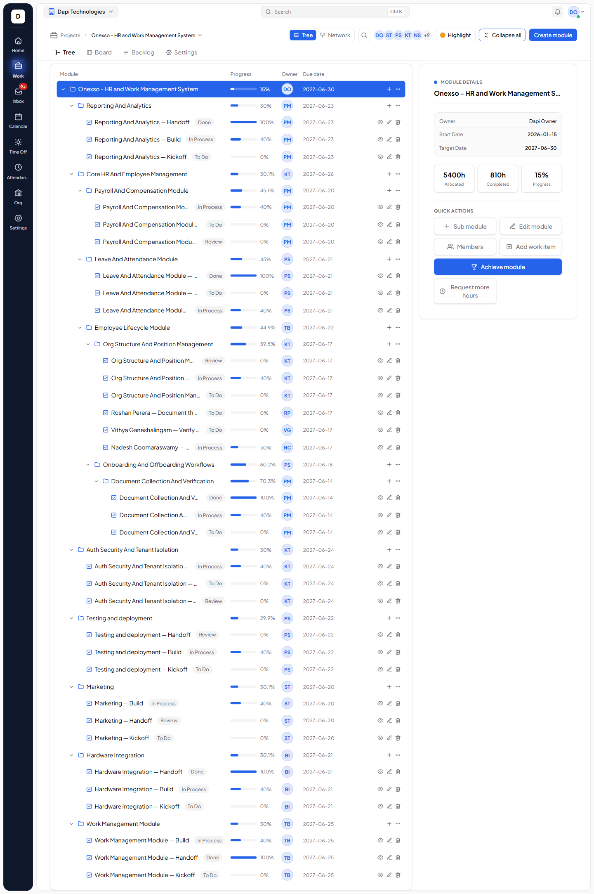

**Expand all** opens every level: modules → sub-modules → tasks.

- Folder icons are modules; checkbox icons are tasks.
- Tasks show a status chip (To Do / In Process / Review / Done), progress bar, assignee and due date.
- Each task row has **View** (eye), **Edit** (pencil) and **Delete** (bin) actions on hover. Module rows have **+** (create sub-module) and **⋯** (more shortcuts).
- Module progress rolls up from its children.

## Step 6 — Tree view 2: Network

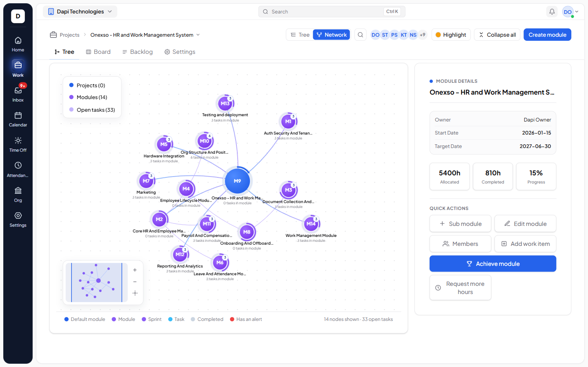

The **Network** switch shows the same project as a node graph.

- The centre node is the root module; the surrounding nodes (M1–M14) are modules, each with its open-task count.
- The top-left legend counts Projects, Modules and Open tasks. The bottom legend explains node colours: Default module, Module, Sprint, Task, Completed, Has an alert.
- The mini-map with zoom controls (bottom left) helps with navigating large projects.
- Clicking a node opens the same Module Details panel as in Tree view.

## Step 7 — Highlight filter: open it

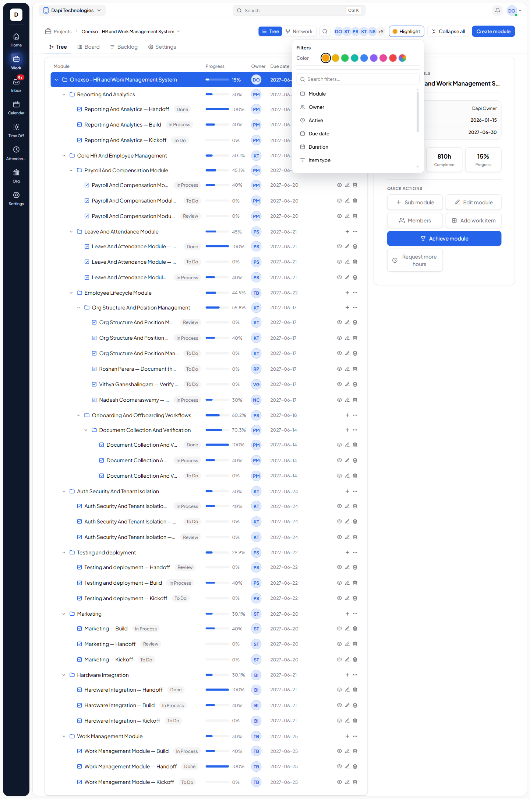

**Highlight** (Tree header) opens the **Filters** popover. Unlike a normal filter, it does **not hide** anything. The whole tree stays visible, and the rows that match are **painted in a colour**, so you can see where they sit in the structure.

- **Color:** eight preset colours plus a custom colour picker (the rainbow swatch).
- **Field list:** Module, Owner, Active, Due date, Duration, Item type, Sprint, Task status, Priority, Category and Progress. The search box narrows the list.

## Step 7a — Highlight: add a first filter (Task status)

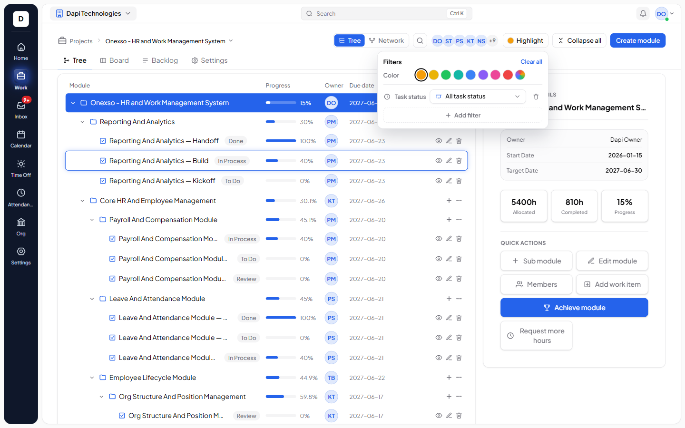

Choosing **Task status** adds a filter row: *Task status | All task status ▾ | 🗑*. The bin removes the row. **+ Add filter** appears under it for more conditions, and **Clear all** (top right) removes every filter.

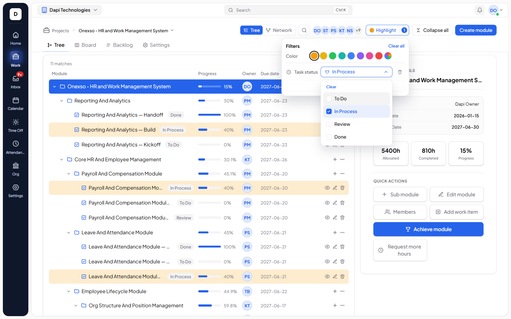

The value dropdown is a multi-select checklist (*To Do, In Process, Review, Done*, plus **Clear**). Ticking **In Process** updates the tree immediately:

- **11 matches** appears above the tree.
- Every In Process task row turns **orange**, the default colour.
- The **Highlight** button shows a **1** badge for one active filter.

## Step 7b — Highlight result: all In Process work

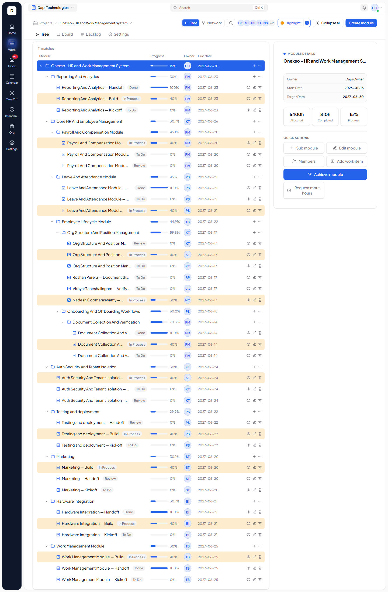

With the popover closed, the fully expanded tree shows the 11 *In Process* tasks in orange across every module: Reporting, Payroll, Leave, Org Structure, Document Collection, Auth Security, Testing, Marketing, Hardware and Work Management. A manager can see at a glance which modules have work in flight, without losing the surrounding structure.

## Step 7c — Highlight: change colour and add a second filter

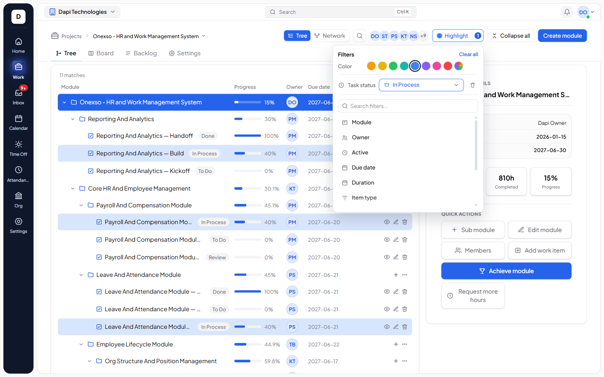

Picking the **blue** swatch recolours the current matches at once. **+ Add filter** then opens the field list again (with search) to add another condition.

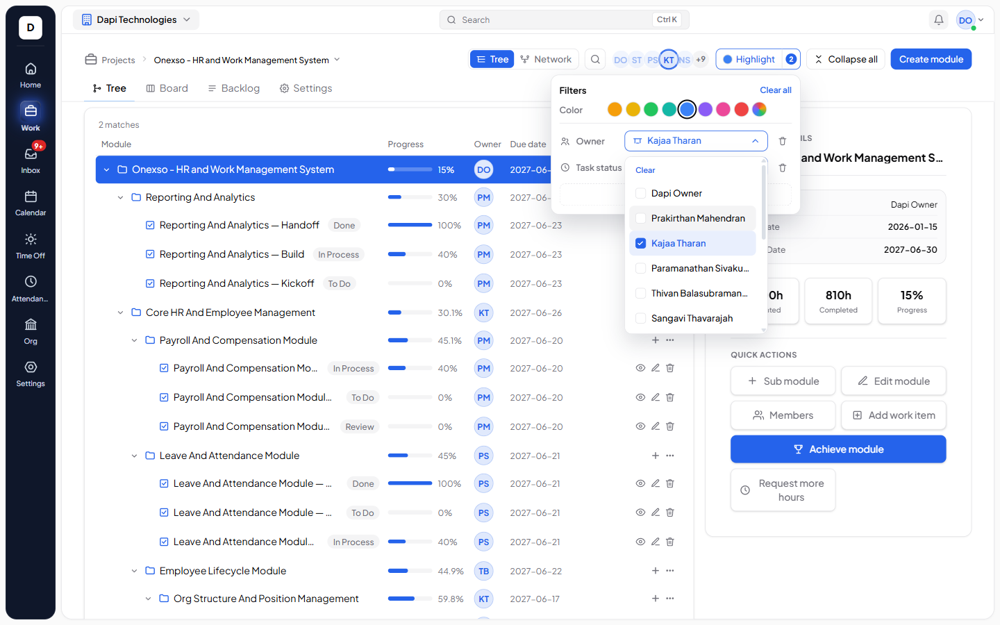

Here **Owner** was added and **Kajaa Tharan** ticked in its people list. Filters **combine with AND**, so only rows that are *In Process* **and** owned by Kajaa Tharan stay highlighted:

- The count drops to **2 matches**.
- The Highlight badge shows **2** active filters.
- The **KT** avatar in the header member strip is ringed, because the Owner filter and the avatar strip are linked.

## Step 7d — Highlight result: combined filters

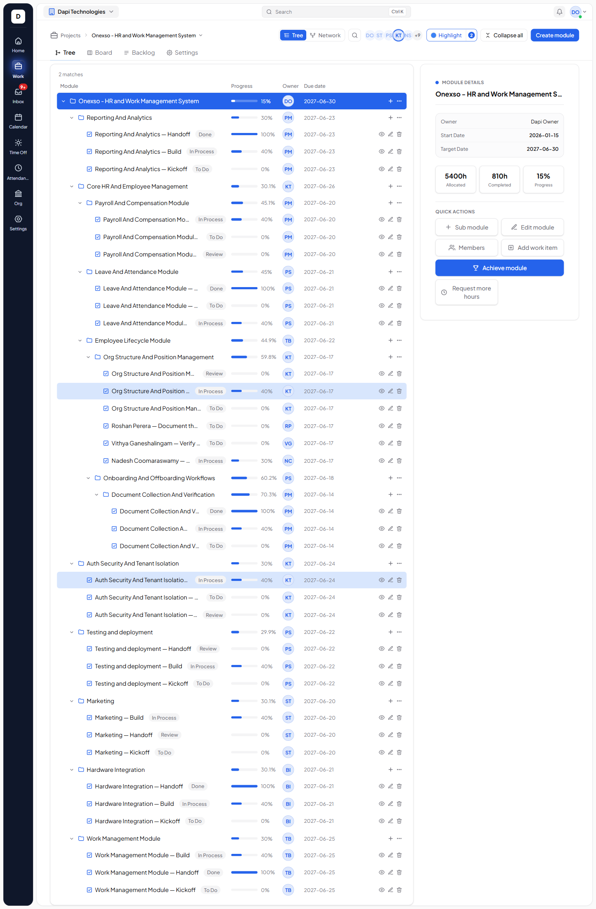

Only two rows are painted blue: *Org Structure And Position…* and *Auth Security And Tenant Isolation…*. These are Kajaa Tharan's two tasks currently In Process. **Clear all** in the popover resets the highlight.

## Step 8 — Select a module

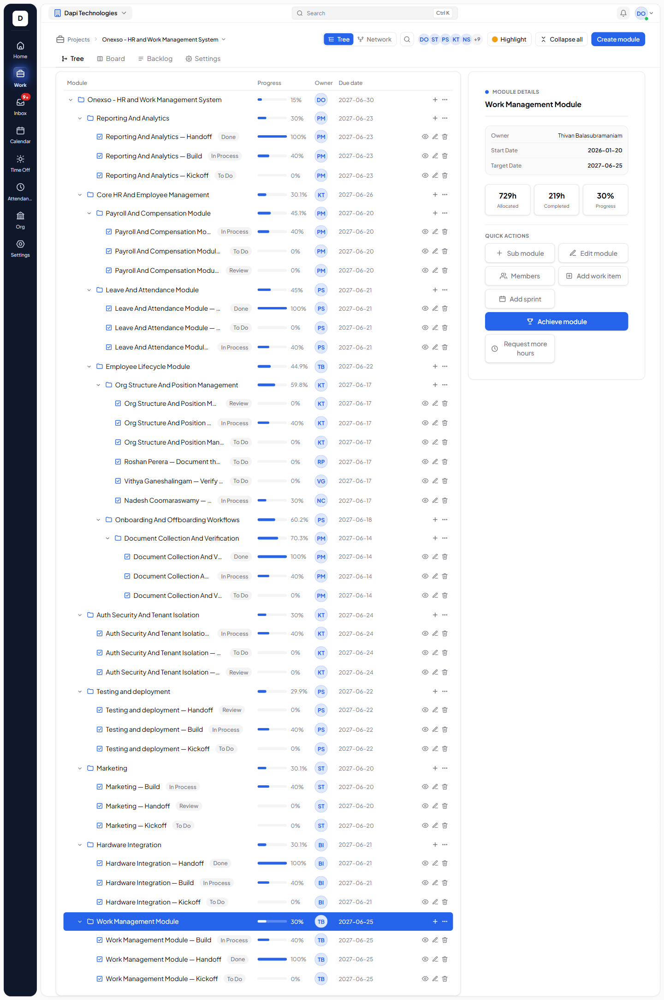

Clicking a module row (here *Work Management Module*) highlights it and loads its **Module Details**: owner, dates, 729h allocated / 219h completed / 30% progress.
Quick actions: **Sub module**, **Edit module**, **Members**, **Add work item**, **Add sprint**, **Achieve module** and **Request more hours**. Requesting more hours sends an approval request to the Inbox.

## Step 9 — Module members

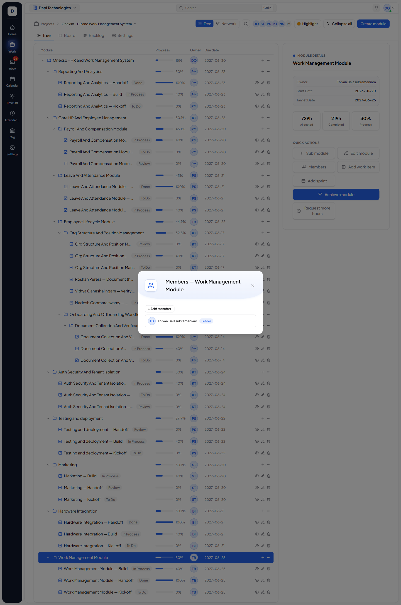

**Members** opens the module's member list, which shows the **Leader** badge. **+ Add member** invites more people. Invitations go through approval and notifications.

## Step 10 — Select a task

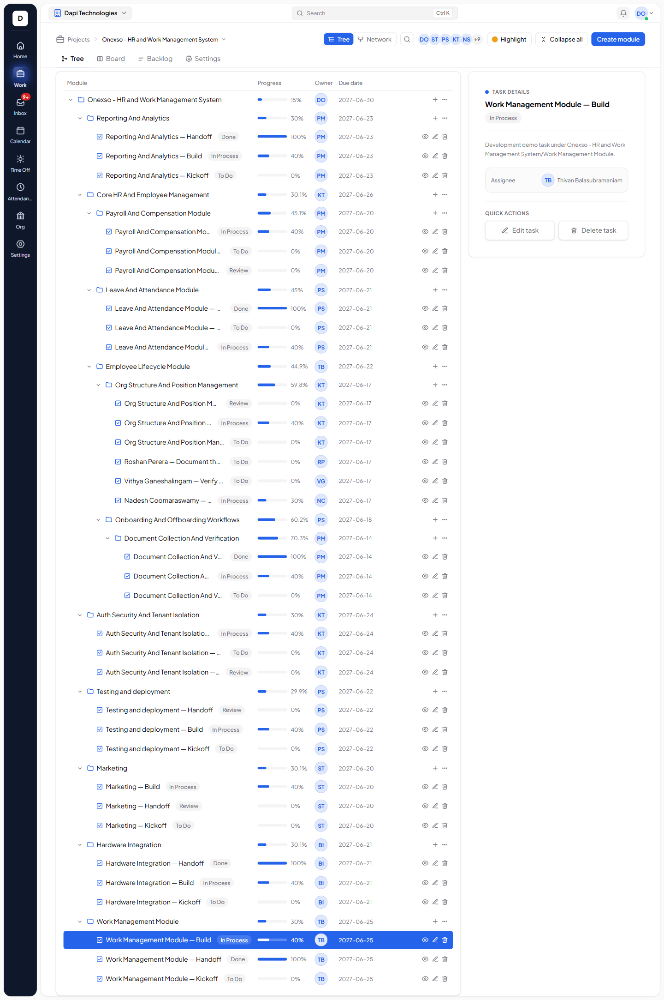

Clicking a task row switches the right panel to **Task Details**: status, description and assignee, plus **Edit task** and **Delete task**.

## Step 11 — View task (full detail modal)

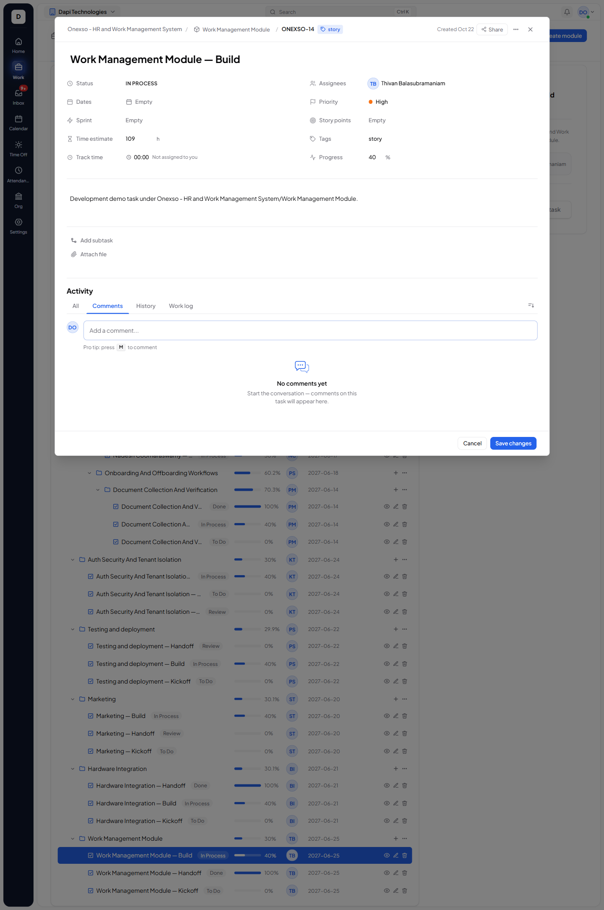

The **View** (eye) action opens the wide task modal.

- **Breadcrumb:** project / module / task key (`ONEXSO-14`) and category tag. **Share** and **⋯** are in the header.
- **Fields:** Status, Dates, Sprint, Time estimate, Track time, Assignees, Priority, Story points, Tags, Progress.
- **Description**, **Add subtask** and **Attach file**.
- The **Activity** section has these tabs: All, Comments, History and Work log. Comments support reactions; the `M` key jumps to the comment box.
- **Save changes / Cancel** in the footer.

## Step 12 — Add a work item

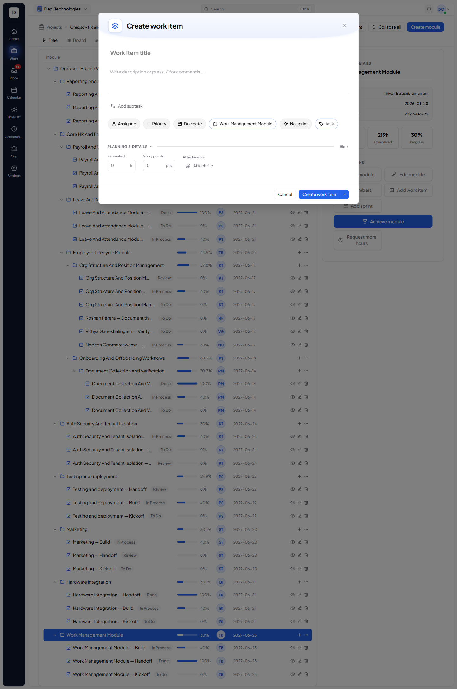

**Add work item** opens the **Create work item** modal, with the selected module already filled in.

- Title, rich description (`/` for commands), Add subtask.
- Chips for Assignee, Priority, Due date, Module, Sprint (optional) and Category (task).
- **Planning & details:** estimated hours, story points and attachments.
- **Create work item**, with a split button for more create options.

## Step 13 — Board

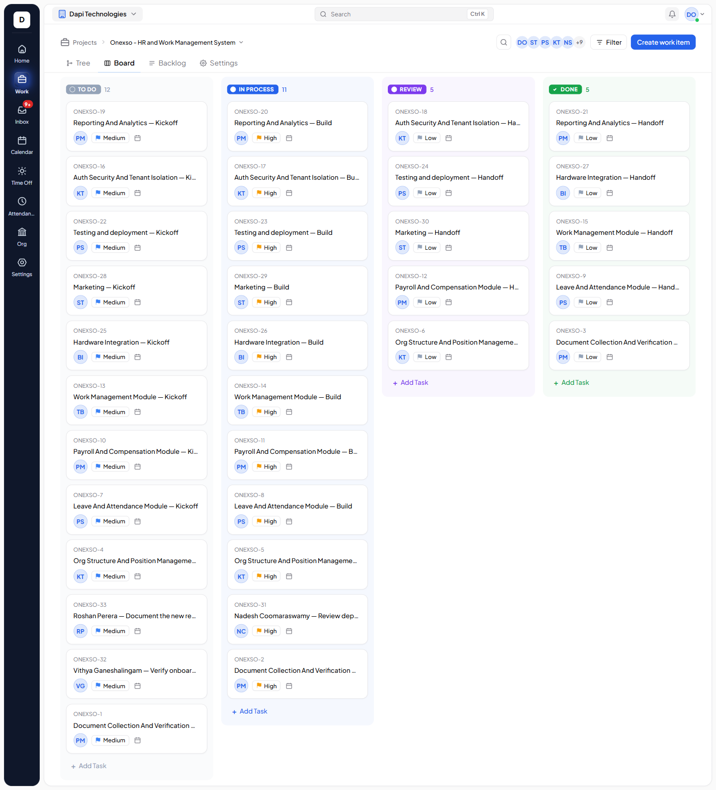

The **Board** tab is a Kanban view of every work item in the project, grouped by status column: **To Do (12) · In Process (11) · Review (5) · Done (5)**.

- Each card shows the task key, title, assignee, priority flag and due-date icon.
- Cards can be dragged between columns to change their status. **+ Add Task** sits at the bottom of each column.
- The header has search, member avatar filter, **Filter** and **Create work item**.

## Step 14 — Backlog

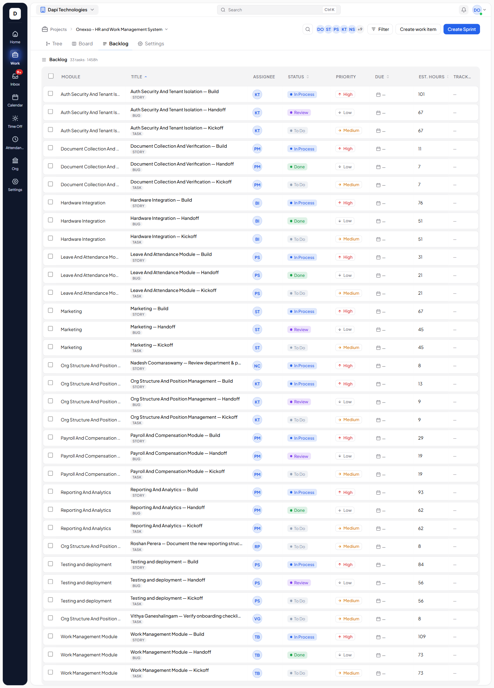

The **Backlog** tab is a sortable table of all work items (33 tasks · 1458h).

- Columns: Module, Title (with category tag), Assignee, Status, Priority, Due, Est. hours and Tracked.
- Row checkboxes support bulk actions.
- The header has **Filter**, **Create work item** and **Create Sprint**.

## Step 15 — Project settings

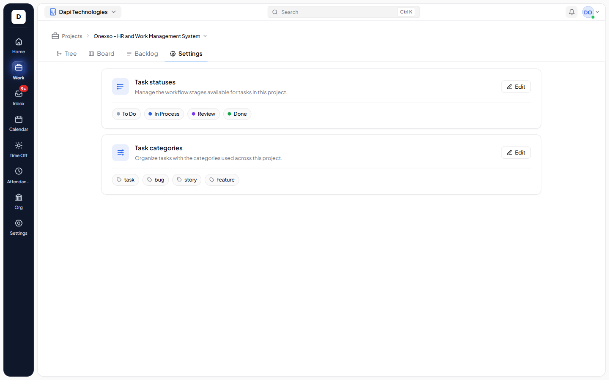

The **Settings** tab manages the project's workflow:

- **Task statuses:** To Do, In Process, Review and Done (editable).
- **Task categories:** task, bug, story and feature (editable).

## Step 16 — Inbox: Work approvals

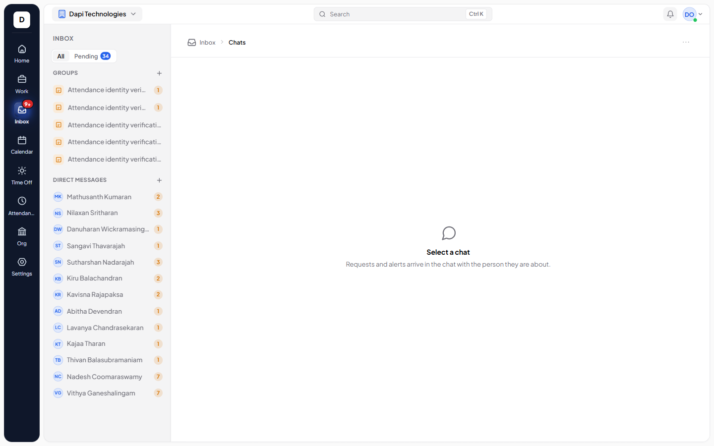

Work Management requests (hour/allocation changes, module member invitations, edits that need approval) arrive in the **Inbox**. The Inbox groups conversations and shows a **Pending** count.

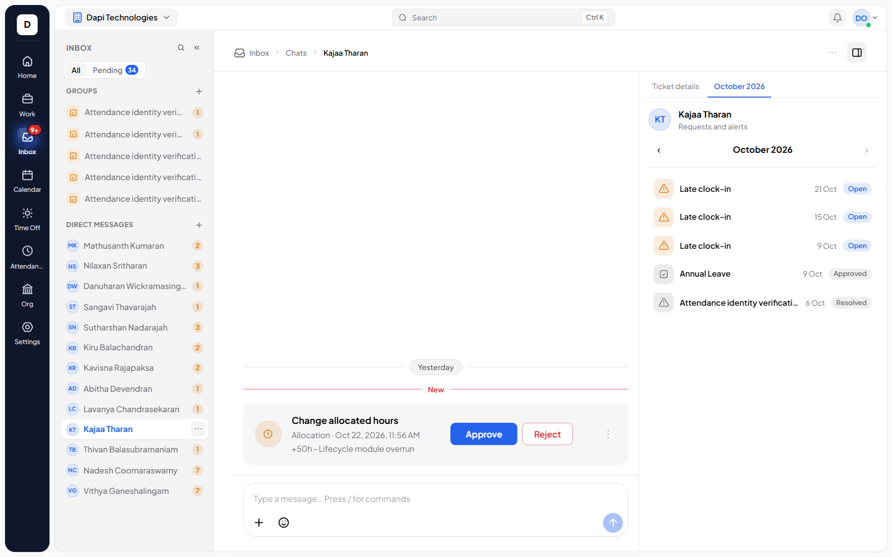

Opening the requester's chat shows the request card. Here it is *Change allocated hours: +50h, Lifecycle module overrun*, with **Approve** / **Reject** buttons. The right panel lists that person's other requests and alerts for the month.

---

## Screenshot index

| # | File | Screen |
|---|------|--------|
| 1 | `01-dashboard.png` | Home dashboard |
| 2 | `02-work-projects.png` | Projects list + Project Details |
| 3 | `03-create-project-modal.png` | Create project wizard |
| 4 | `04-tree-view.png` | Tree tab (collapsed) |
| 5 | `05-tree-view-expanded.png` | Tree view (fully expanded, full page) |
| 6 | `06-network-view.png` | Network view |
| 7 | `07-tree-highlight-filter.png` | Highlight filter popover |
| 7a | `07b-highlight-task-status-options.png` | Task status filter row |
| 7a | `07d-highlight-status-selected.png` | In Process ticked (11 matches) |
| 7b | `07e-highlight-in-process-result.png` | In Process highlighted (full tree) |
| 7c | `07f-highlight-add-filter-menu.png` | Blue colour + Add filter menu |
| 7c | `07g-highlight-two-filters.png` | Owner = Kajaa Tharan (2 matches) |
| 7d | `07h-highlight-combined-result.png` | Combined highlight (full tree) |
| 8 | `08-module-selected-details.png` | Module selected + details |
| 9 | `09-module-members-popup.png` | Module members |
| 10 | `10b-task-selected-panel.png` | Task selected + details |
| 11 | `10-task-view-modal.png` | Task detail modal |
| 12 | `11-add-work-item-modal.png` | Create work item |
| 13 | `12-board.png` | Board (Kanban) |
| 14 | `13-backlog.png` | Backlog table |
| 15 | `14-project-settings.png` | Project settings |
| 16 | `15-inbox-approvals.png` | Inbox |
| 17 | `16-inbox-wm-approval-chat.png` | Work approval request in chat |
